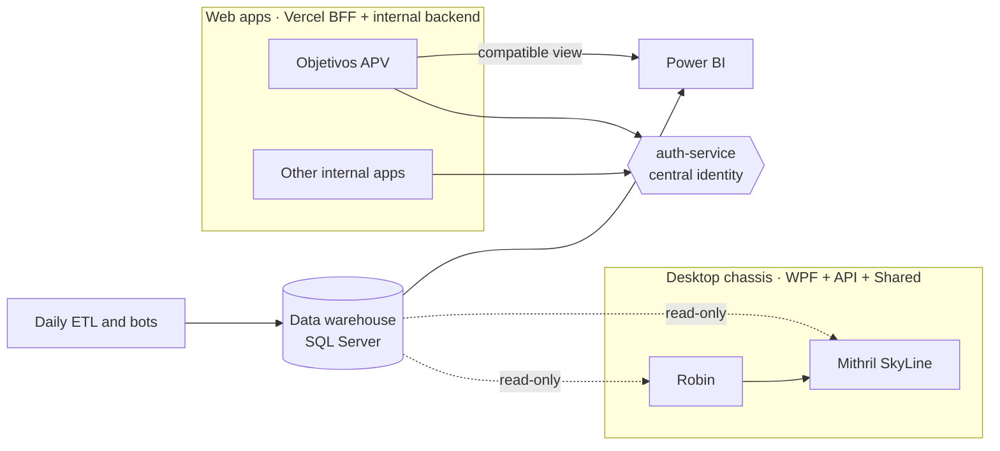

<picture>
  <source media="(prefers-color-scheme: dark)" srcset="assets/banner-dark.svg">
  
</picture>

<b>English</b> · <a href="README.es.md">Español</a>

I work in **Business Intelligence** for a network of car dealerships in Mexico. My work starts
where the dashboard ends: when a process lives in a shared spreadsheet, in email threads or in
someone's head, I turn it into an app with permissions, an audit trail and numbers that
reconcile with Power BI.

- I build **desktop apps (.NET/WPF)** and **web apps**, each with its own API, database and centralized identity.
- I maintain the **ETL jobs and bots** that feed the data warehouse every day.
- I also take **freelance** projects: desktop and web apps built end to end for outside clients.
- I care that each business rule lives **in one place, under test**, and that no client can bypass it.

## At work

In-house software for a network of car dealerships, in production and used daily.

<table>
  <tr>
    <td width="50%" valign="top">
      
      <h3><a href="https://github.com/tochtlani/robin-dms">Robin</a></h3>
      
Desktop DMS for vehicle files by VIN and voucher allocation. WPF client, JWT-secured API, per-field permissions enforced on the server and field-level audit history.

      <code>C#</code> <code>.NET 10</code> <code>WPF/MVVM</code> <code>ASP.NET Core</code> <code>SQL Server</code>
    </td>
    <td width="50%" valign="top">
      
      <h3><a href="https://github.com/tochtlani/mithril-skyline">Mithril SkyLine</a></h3>
      
Daily cash-flow tracking per dealership, with per-day locking and admin-controlled reopening. Domain rules are pure code shared by client and server, covered by 262 tests.

      <code>C#</code> <code>.NET 10</code> <code>WPF</code> <code>xUnit</code> <code>Inno Setup</code>
    </td>
  </tr>
  <tr>
    <td width="50%" valign="top">
      
      <h3><a href="https://github.com/tochtlani/objetivos-apv">Objetivos APV</a> · <a href="https://tochtlani.github.io/objetivos-apv/">demo ▶</a></h3>
      
Monthly sales targets per advisor, captured from a phone, with assignment history, month-end close and a view that plugs into the existing Power BI model unchanged.

      <code>JavaScript</code> <code>Node/Express</code> <code>Vercel</code> <code>SQL Server</code> <code>Power BI</code>
    </td>
    <td width="50%" valign="top">
      
      <h3><a href="https://github.com/tochtlani/auth-service">auth-service</a> · <a href="https://tochtlani.github.io/auth-service/">demo ▶</a></h3>
      
Central identity for the whole fleet of internal apps: one person, one password, one role per app. Per-person IP allowlists, an admin panel kept off the public internet, and a full audit log.

      <code>Node.js</code> <code>Express</code> <code>scrypt</code> <code>Tailscale Funnel</code> <code>SQL Server</code>
    </td>
  </tr>
</table>

## Freelance

Projects built on demand for outside clients.

<table>
  <tr>
    <td width="100%" valign="top">
      
      <h3><a href="https://github.com/tochtlani/nomina-quincenal">Nómina Quincenal</a></h3>
      
Biweekly payroll for a multi-company group, built end to end for a client: calculation rules derived cell by cell from their spreadsheet, segregation of duties (whoever submits a pay period cannot approve it), loans, vacation premium and cash forecasting. 550 tests, client and server installers.

      <code>C#</code> <code>.NET 10</code> <code>WPF</code> <code>ASP.NET Core</code> <code>SQL Server</code> <code>xUnit</code>
    </td>
  </tr>
</table>

Project docs are written in Spanish; the demos speak for themselves.

## How they fit together

The in-house projects aren't standalone: they share identity, deployment patterns and a desktop
"chassis" that carries over from one app to the next.

## Tools I use

  

**Data:** SQL Server (T-SQL, views, stored procedures, idempotent migrations), Power BI (DAX, `.pbip` semantic models), MySQL, Python ETL.
**Infra:** Tailscale (Funnel / serve), Windows Server, Proxmox, Windows services and scheduled tasks.

## How I work

- **The server is the only authority.** Permissions, calculations and locks are enforced by the API; the client just reflects them.
- **The rules that matter are pure code with tests.** No database or UI in the way.
- **Credentials never reach the client.** Not the connection string, not the SQL password.
- **I document the why, not just the what.** Every repo has a design-decisions section, including the paths I ruled out.
- **I migrate without breaking what exists.** If Power BI reads a table, the new source keeps its columns.

---

Everything above runs in production, in-house or at a client. The business code is private;
each repo contains documentation, screenshots and a demo with fictional data.
