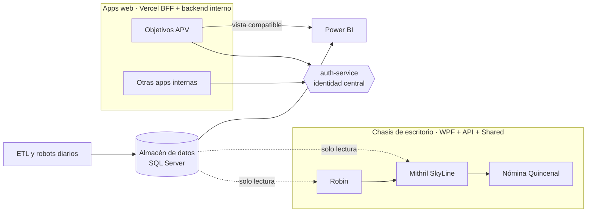

<picture>
  <source media="(prefers-color-scheme: dark)" srcset="assets/banner-dark.svg">
  
</picture>

Trabajo en el área de **Business Intelligence** de una red de concesionarios automotrices en
México. Mi trabajo empieza donde termina el dashboard: cuando un proceso vive en un Excel
compartido, en correos o en la memoria de alguien, lo convierto en una app con permisos,
auditoría y datos que cuadran con Power BI.

- Construyo **apps de escritorio (.NET/WPF)** y **apps web** con su API, base de datos e identidad centralizada.
- Mantengo los **ETL y robots** que alimentan el almacén de datos todos los días.
- Me importa que la regla de negocio viva **en un solo lugar, probada**, y que el cliente no pueda saltársela.

## Proyectos destacados

<table>
  <tr>
    <td width="50%" valign="top">
      
      <h3><a href="https://github.com/tochtlani/robin-dms">Robin</a></h3>
      
DMS de escritorio para expedientes por VIN y prorrateo de vales. Cliente WPF, API con JWT, permisos por campo validados en el servidor y auditoría a nivel de campo.

      <code>C#</code> <code>.NET 10</code> <code>WPF/MVVM</code> <code>ASP.NET Core</code> <code>SQL Server</code>
    </td>
    <td width="50%" valign="top">
      
      <h3><a href="https://github.com/tochtlani/mithril-skyline">Mithril SkyLine</a></h3>
      
Control diario del flujo de dinero por agencia, con bloqueo por día calendario y desbloqueo administrado. Las reglas de dominio son código puro compartido entre cliente y servidor, cubierto por 262 pruebas.

      <code>C#</code> <code>.NET 10</code> <code>WPF</code> <code>xUnit</code> <code>Inno Setup</code>
    </td>
  </tr>
  <tr>
    <td width="50%" valign="top">
      
      <h3><a href="https://github.com/tochtlani/nomina-quincenal">Nómina Quincenal</a></h3>
      
Cálculo y autorización de nómina con segregación de funciones: quien envía una quincena no puede autorizarla. Préstamos, faltas, prima vacacional y pronóstico de efectivo; 550 pruebas.

      <code>C#</code> <code>.NET 10</code> <code>WPF</code> <code>SQL Server</code>
    </td>
    <td width="50%" valign="top">
      
      <h3><a href="https://github.com/tochtlani/objetivos-apv">Objetivos APV</a> · <a href="https://tochtlani.github.io/objetivos-apv/">demo ▶</a></h3>
      
Captura mensual de objetivos por asesor desde el celular, con historia de asignaciones, cierre de mes y una vista compatible con el modelo de Power BI existente.

      <code>JavaScript</code> <code>Node/Express</code> <code>Vercel</code> <code>SQL Server</code> <code>Power BI</code>
    </td>
  </tr>
  <tr>
    <td colspan="2" valign="top">
      <h3><a href="https://github.com/tochtlani/auth-service">auth-service</a> · <a href="https://tochtlani.github.io/auth-service/">demo ▶</a></h3>
      
Identidad central para toda la flota de apps: una persona, una contraseña, un rol por app. Lista blanca de IP por persona, panel de administración aislado de internet y bitácora de auditoría.

      <code>Node.js</code> <code>Express</code> <code>scrypt</code> <code>Tailscale Funnel</code> <code>SQL Server</code>
    </td>
  </tr>
</table>

## Cómo encajan

No son proyectos sueltos: comparten identidad, patrones de despliegue y un "chasis" de
escritorio que se reutiliza de una app a la siguiente.

## Con qué trabajo

  

**Datos:** SQL Server (T-SQL, vistas, procedimientos, migraciones idempotentes), Power BI (DAX, modelos semánticos `.pbip`), MySQL, ETL en Python.
**Infra:** Tailscale (Funnel / serve), Windows Server, Proxmox, servicios y tareas programadas de Windows.

## Cómo trabajo

- **El servidor es la única autoridad.** Permisos, cálculos y bloqueos se validan en la API; el cliente solo los refleja.
- **Las reglas que importan son código puro y tienen pruebas.** Sin base de datos ni UI de por medio.
- **Las credenciales nunca llegan al cliente.** Ni la cadena de conexión ni el password de SQL.
- **Documento el porqué, no solo el qué.** Cada repo tiene su sección de decisiones, incluidas las que se descartaron.
- **Migro sin romper lo que ya existe.** Si Power BI consume una tabla, la nueva fuente respeta sus columnas.

---

Los proyectos de arriba están en producción dentro de la empresa. Su código de negocio es
privado; cada repo contiene documentación, capturas y una demo con datos ficticios.
